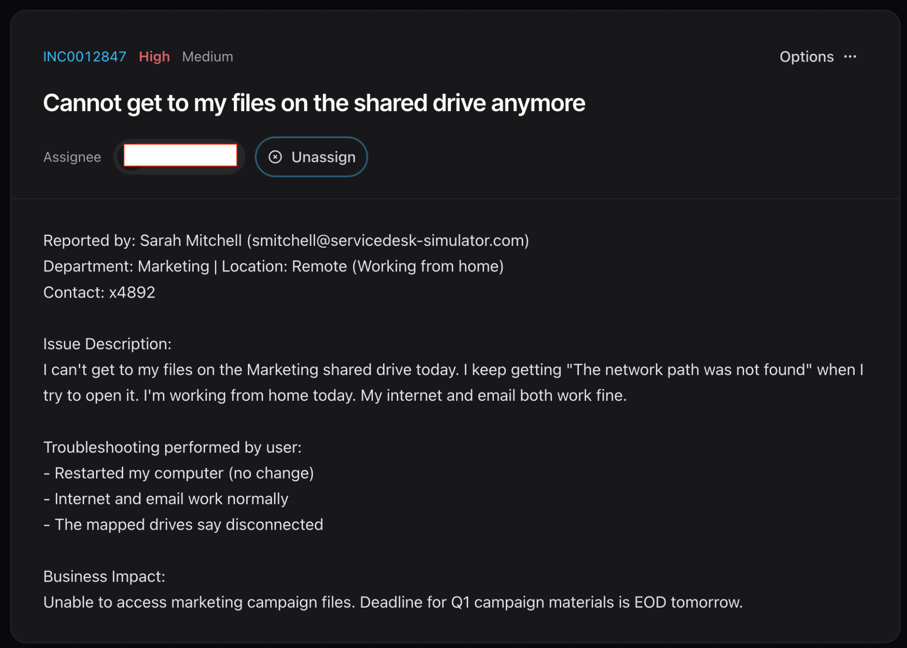
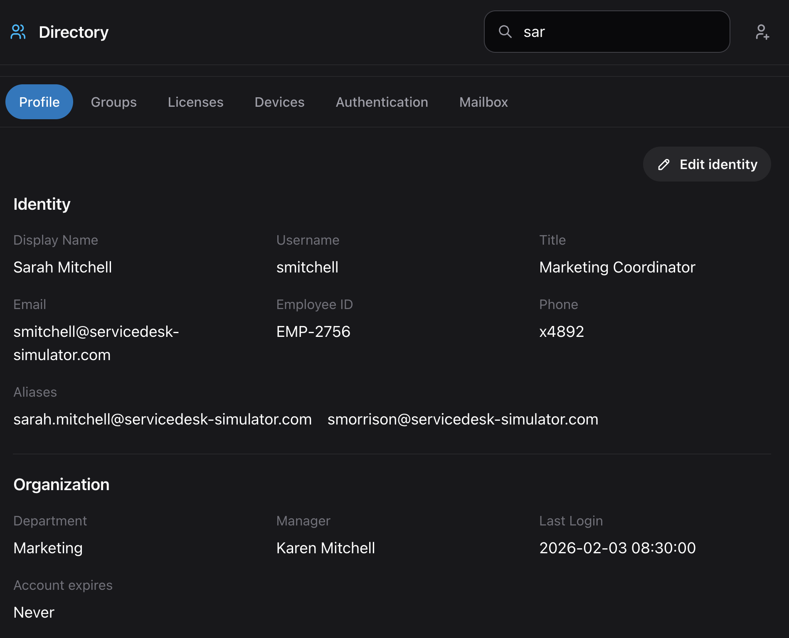
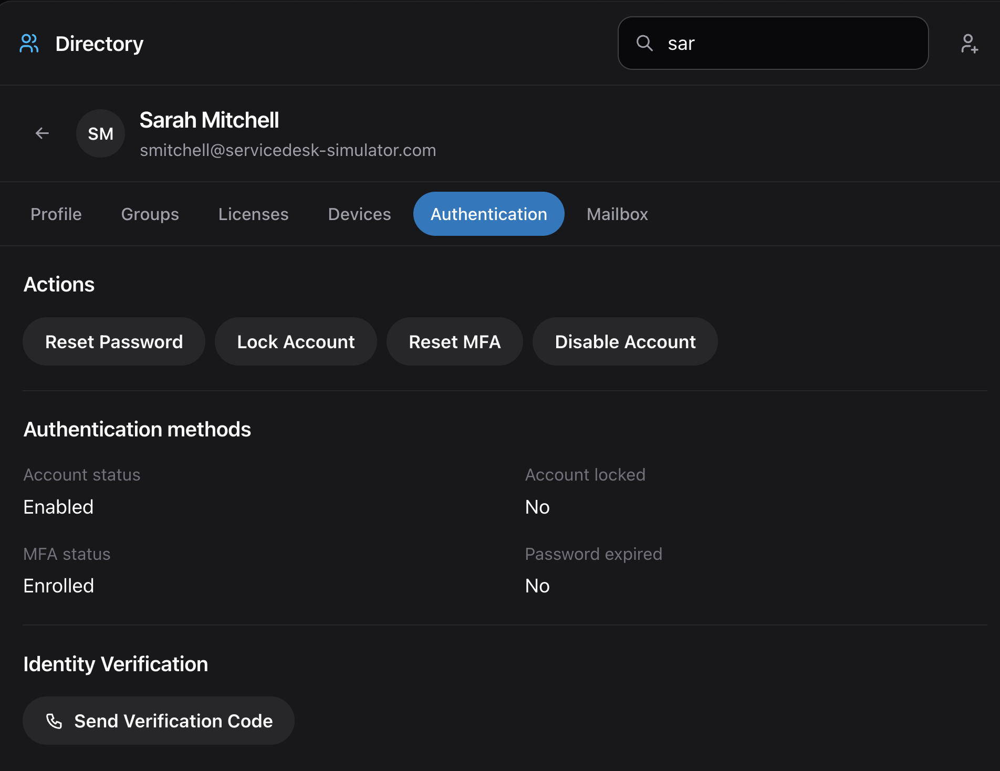
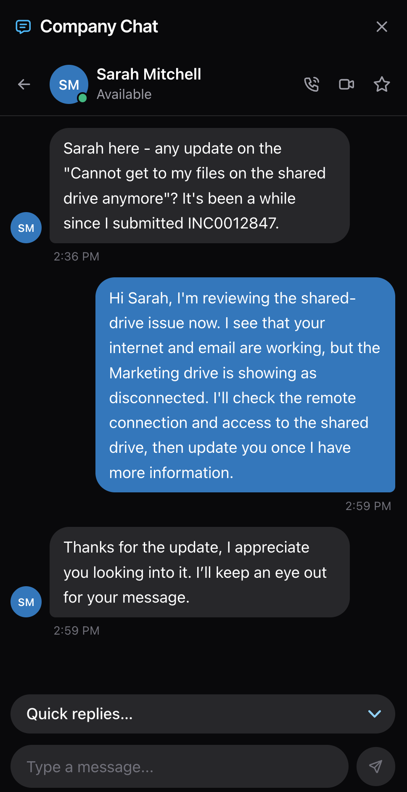
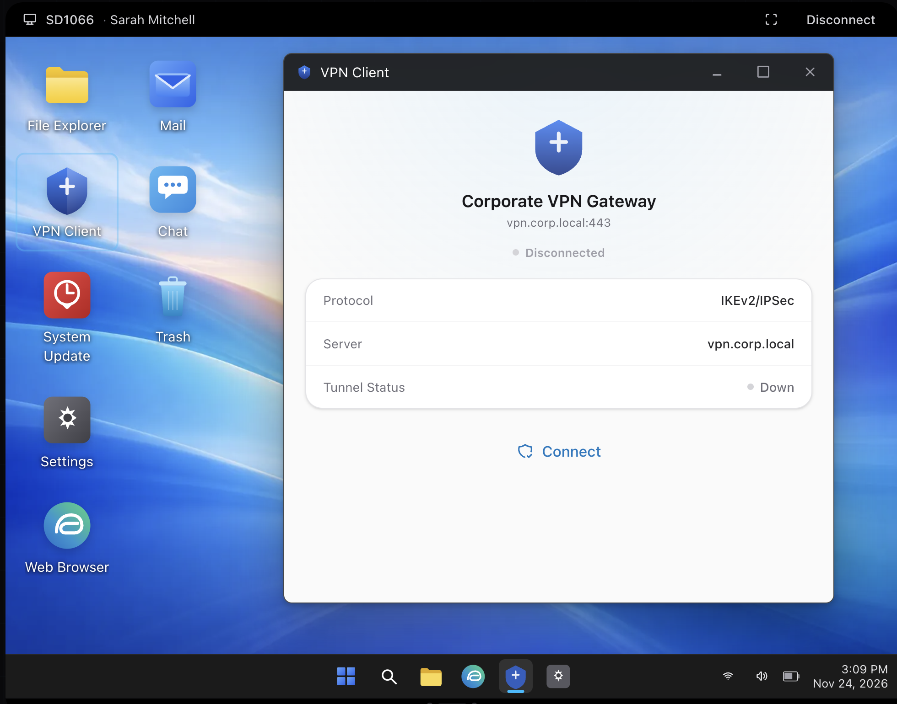
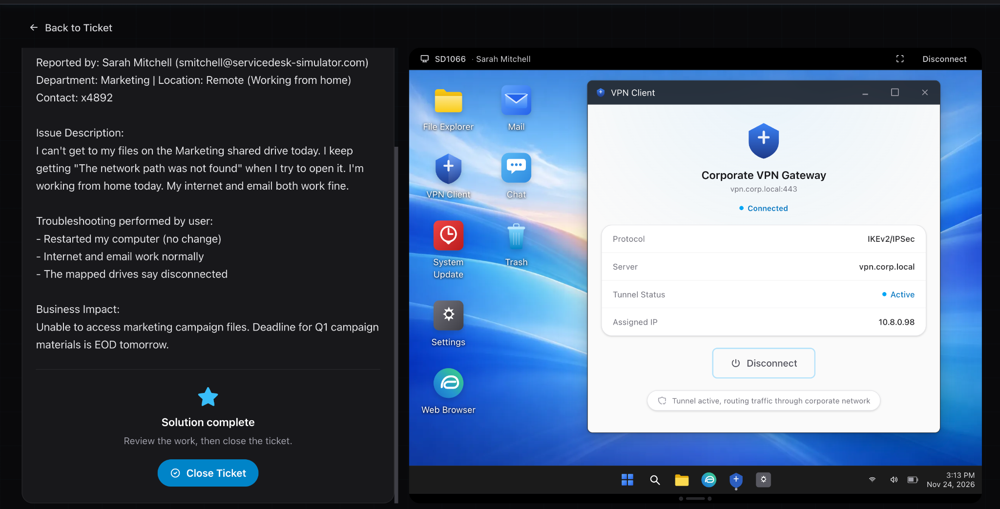
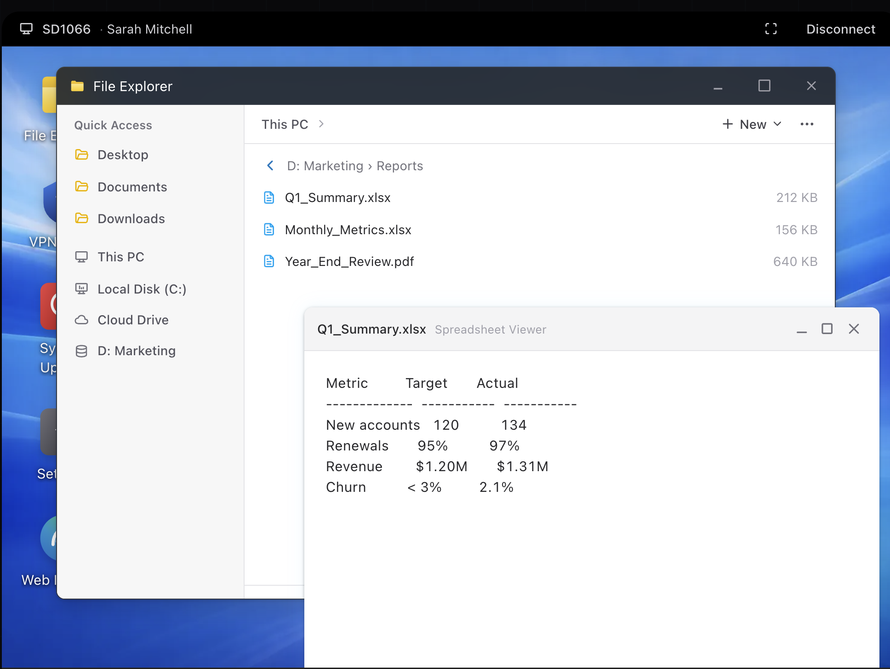
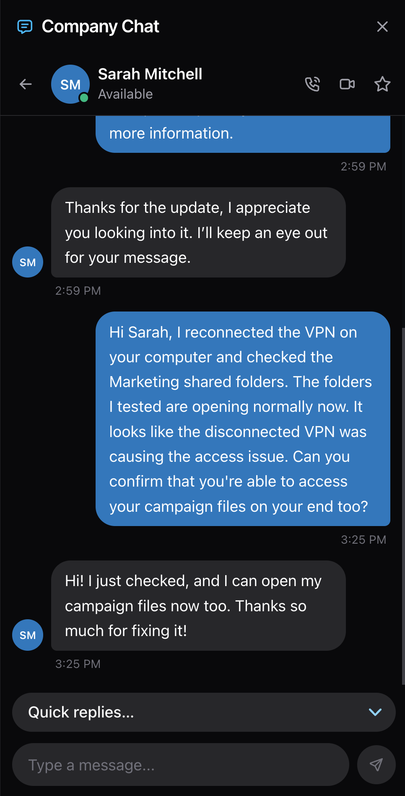

# Entry 01: Marketing Shared Drive Access

- **Ticket ID:** INC0012847
- **Ticket title:** Cannot get to my files on the shared drive anymore
- **Priority:** High
- **Date completed:** Nov 24, 2026
- **Status:** Closed
- **Environment:** Service Desk Simulator (simulated environment only)

## 1. What the user reported

Sarah Mitchell, a Marketing Coordinator working from home, couldn't open the Marketing shared drive. She got the error "The network path was not found."

- Her internet and email were working normally.
- She had already restarted her computer and nothing changed.
- Her mapped drives showed as disconnected.
- She needed her campaign files for a Q1 deadline at the end of the next day.

## 2. What I checked

1. **Read the ticket.** Her internet and email worked, so I didn't think the whole connection was down. Since she was working from home and the mapped drives said disconnected, I suspected the remote connection to the company network before touching the drive mapping or permissions.
2. **Directory, Profile.** Looked up Sarah: username `smitchell`, Marketing department, manager Karen Mitchell.
3. **Directory, Groups.** Domain Users, Marketing, Printer-Users. She was in the Marketing group, so a missing group membership was less likely. That didn't rule out a share-permission problem.
4. **Directory, Authentication.** Account enabled, not locked, MFA enrolled, password not expired. That ruled out those account problems.
5. **Replied to Sarah in Company Chat.** She had messaged at 2:36 PM asking for an update. I replied at 2:59 PM that I'd seen her internet and email were working but the Marketing drive showed disconnected, and that I'd check the remote connection and shared drive access, then update her.
6. **Remote Desktop.** Connected to her simulated workstation (SD1066) with my admin login.
7. **VPN Client.** The VPN was disconnected and the tunnel status was Down.
8. **Reconnected the VPN.** Clicked Connect. Status changed to Connected and the tunnel showed Active.
9. **Tested the drive.** In File Explorer I opened the D: Marketing drive, went into Reports, and opened Q1_Summary.xlsx. It opened normally.
10. **Told Sarah and asked her to verify.** She confirmed she could open her campaign files.
11. **Closed the ticket.**

## 3. Root cause

The VPN was disconnected, so Sarah's home workstation couldn't reach the corporate file server. The simulator's solution review explained that her drive mapping was never broken. It was just offline because the workstation couldn't reach the server, and it reconnected once the tunnel came back.

## 4. Resolution

I reconnected the VPN on her workstation, confirmed it showed Connected with an Active tunnel, opened the Marketing drive to check the files, and then had Sarah confirm from her side before closing the ticket.

## 5. How I confirmed it was fixed

- **Technical check:** VPN Connected, tunnel Active, and I opened a file from the Marketing drive.
- **User check:** Sarah confirmed in Company Chat that she could open her campaign files.

The site marked the solution complete as soon as the VPN was back, but I still tested the drive and asked Sarah, because a VPN showing Connected doesn't prove the files open.

## 6. Messages I sent to the user

**First update (2:59 PM), before I made any changes:**

> Hi Sarah, I'm reviewing the shared-drive issue now. I see that your internet and email are working, but the Marketing drive is showing as disconnected. I'll check the remote connection and access to the shared drive, then update you once I have more information.

**After the fix (3:25 PM):**

> Hi Sarah, I reconnected the VPN on your computer and checked the Marketing shared folders. The folders I tested are opening normally now. It looks like the disconnected VPN was causing the access issue. Can you confirm that you're able to access your campaign files on your end too?

## 7. Knowledge base note

**Problem:** A remote employee can't open a mapped company shared drive and gets a network-path error, but internet and email work.

1. Confirm general internet works and check whether the VPN is connected.
2. If the VPN is disconnected, reconnect it and confirm the tunnel is active.
3. Test the mapped drive and have the user confirm they can open their files.
4. If the drive is still unavailable, check the documented file-server path and look at connectivity, permissions, and server availability.
5. Only remap the drive if it's still missing after connectivity is restored.

## 8. What I learned / what I'd do differently

- A disconnected mapped drive doesn't always mean the mapping is broken. For a remote user with working internet and email, the VPN is a good first check.
- Verify the fix yourself and confirm with the user before closing the ticket.
- Next time I'd check the simplest likely cause first, avoid unnecessary changes, and write down each step as I go. I'd also open Documentation early to know the file server path in case a remap is needed.

## 9. When I'd escalate and to whom

If reconnecting the VPN didn't fix it, I'd keep checking before escalating, then:

- **Network team:** the VPN won't connect, the tunnel fails, or it looks like a routing or connectivity problem.
- **Server or storage team:** the file server or share looks unavailable for multiple users.
- **Access / directory admins:** the user can reach the server but gets access denied because of group membership or file permissions.

I'd put the original error, the checks I did, the results, the business impact, and the remaining symptoms in the escalation notes.

## 10. Limitations

This was a simulated exercise. The workstation, directory, VPN, chat, and ticket lifecycle were all part of the simulator. It does not represent production IT experience.

## 11. Evidence

Screenshots come from my own simulator session.

**Original ticket**

**Directory: Sarah's profile** (I also checked her Groups tab: Domain Users, Marketing, Printer-Users)

**Directory: authentication status (enabled, not locked, MFA enrolled, password not expired)**

**Company Chat: Sarah's 2:36 PM follow-up and my 2:59 PM reply**

**VPN Client before: Disconnected, tunnel Down**

**VPN Client after: Connected, tunnel Active**

**Marketing drive opening, Q1_Summary.xlsx open**

**Sarah's confirmation in Company Chat**

